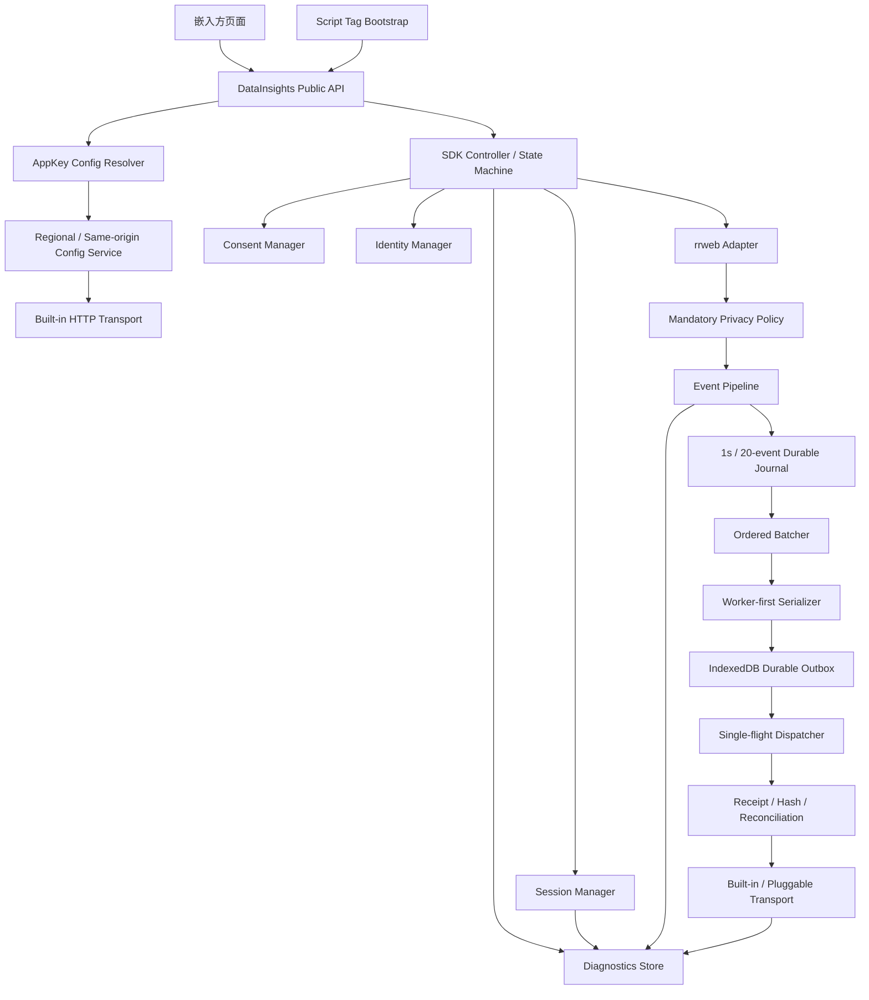
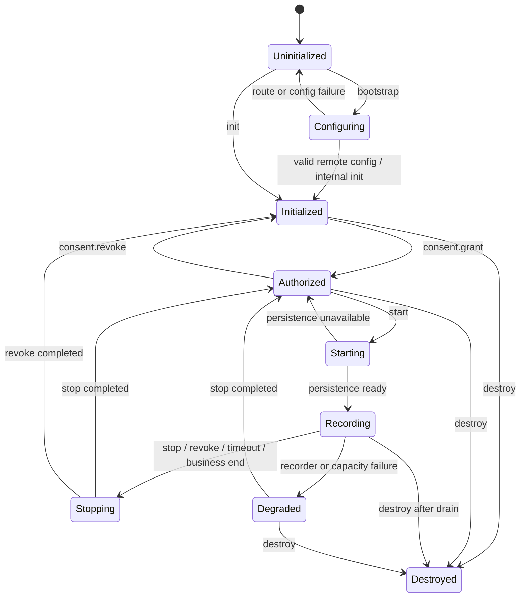
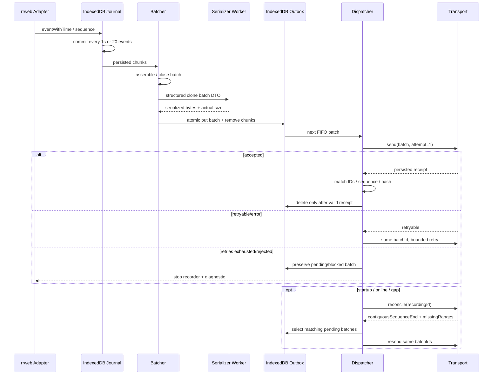

# DI-1001 DataInsights 前端 SDK 技术设计文档 v1.4

## 1. 背景与目标

### 1.1 背景

DI-1001 要在 rrweb Fork 内构建面向保险投保流程的 DataInsights 浏览器 SDK。SDK 必须在用户授权后完整录制每一次投保过程，用于销售可回溯和纠纷核验；同时需要隔离 SDK 故障、保护密码与认证信息，并控制对 rrweb 上游源码的侵入，保证后续可以持续同步官方版本。

### 1.2 设计目标

1. 在 `packages/datainsights-browser-sdk` 建立独立产品层，首期按 L0 侵入等级实现。
2. 定义稳定、可版本化且不泄露 rrweb 内部类型的公共 API。
3. 建立授权、身份、投保 Journey、Session、Recording、Segment 的明确状态和数据边界。
4. 使用单向、有界、可诊断的事件管道向可插拔 Transport 输出批次。
5. 通过强制隐私配置、错误隔离、资源释放和沙箱回放建立安全边界。
6. 复用当前 Yarn、Turbo、TypeScript、Vite、Vitest 和 Puppeteer 工具链。

### 1.3 范围

**包含：**

- `@datainsights/browser-sdk` 公共 API 与 Script Tag 全局入口；
- rrweb recorder 适配、授权后启动、100% 投保录制；
- 身份、Session、Journey、Recording、Segment 生命周期；
- 隐私策略、批次、序列、IndexedDB durable outbox、Worker 序列化和 Transport 抽象；
- AppKey 路由解析、远程配置客户端、标准 HTTP Transport 和简化 `bootstrap()`；
- IndexedDB 运行时兼容探测及去生产化保险产品真实录制/回放 E2E；
- 内存、下载文件和 Mock HTTP Transport；
- 诊断、故障隔离、资源释放、构建、测试及上游升级约束。

**不包含：**

- 生产接收 API、鉴权、租户、数据库、对象存储和分析系统；
- `appKey` 的管理后台、`appSecret` 签发/轮换、短期凭证服务和服务端验签；
- 配置中心、Collector 接收端、服务端持久化和正式回放控制台；
- FingerprintJS、网络请求正文录制、Canvas/WebGL 录制；
- 服务端证据签名、存证、留存、访问控制和法律效力认定。

## 2. 现有系统约束

| 约束 | 当前事实 | 设计响应 |
| --- | --- | --- |
| Monorepo | Yarn 1.22.19 workspace + Turbo | 新包放入 `packages/*`，自动进入 workspace |
| 构建 | TypeScript 5.4.5 + Vite 6，共享 `vite.config.default.ts` | 复用共享配置和类型声明生成机制 |
| 测试 | Vitest 1.6.1 + Puppeteer 20.9 | 单元测试沿用 Vitest，浏览器集成沿用 Puppeteer并补跨浏览器 smoke 层 |
| Recorder | `@rrweb/record` 公开 `record`；rrweb 提供快照、插件、错误处理和 stop handle | 仅通过公开入口适配，不引用核心内部文件 |
| browser-client | 绑定 rrweb Cloud WebSocket/HTTP、公开 API key、模块级全局状态 | 不复用其运行时，仅参考构建和测试模式 |
| 安全上下文 | Replay 数据一律视为 Untrusted Replay Data | 本地回放仅允许 Sandboxed Rebuild |
| 录制实例 | rrweb recorder 使用模块级状态，单页只适合一个活动 recorder | DataInsights v1 明确采用单实例模型 |

SGS Tech 中面向 Java、DDD、数据库和 REST 的规则不适用于本次纯浏览器 TypeScript 包；本设计采用其“模块边界、契约先行、异常分类、性能预算和测试分层”原则。数据库、REST API 和事务设计明确不适用。

## 3. 方案比较与关键决策

### 3.1 DataInsights 产品层落点

| 方案 | 优点 | 缺点 | 结论 |
| --- | --- | --- | --- |
| A. 新增独立 `datainsights-browser-sdk` 包 | 产品 API 与 rrweb 解耦；上游同步冲突最少；可独立版本化 | 新增一层适配与测试 | **采用** |
| B. 扩展 `packages/browser-client` | 可复用部分生命周期和网络代码 | 强绑定 rrweb Cloud 协议、API key 和 WebSocket；产品语义混杂 | 不采用 |
| C. 直接修改 `record`/`rrweb` 核心 | 调用链短 | 升级冲突和协议风险最高，违背低侵入目标 | 不采用 |

**决策 D-01：** 首期限定为 L0，只新增 DataInsights 包、示例和测试。若公共扩展点确实不足，必须先形成单独 ADR，将修改升级为 L1/L2；不得在普通实现任务中顺手修改 rrweb 核心。

### 3.2 公共 API 错误语义

| 方案 | 优点 | 缺点 | 结论 |
| --- | --- | --- | --- |
| 抛异常 | 符合部分 JS API 习惯 | 未捕获异常可能影响宿主投保流程 | 不采用为默认运行时语义 |
| 静默吞错 | 宿主不崩溃 | 无法诊断，容易造成无录制却不自知 | 不采用 |
| 返回结构化 Result，并内部捕获异常 | 不破坏宿主；调用方可检查；便于测试 | API 稍显冗长 | **采用** |

**决策 D-02：** 所有公共方法返回 `SDKResult<T>` 或 `Promise<SDKResult<T>>`。配置编程错误、状态冲突和运行故障都转换为稳定错误码；SDK 内部不得向宿主抛出未捕获异常。

### 3.3 事件顺序与序列号

| 方案 | 优点 | 缺点 | 结论 |
| --- | --- | --- | --- |
| 使用 rrweb sequential-id 插件修改事件 | 已有插件 | 污染 rrweb 原始事件形态；序列与批次协议耦合 | 不采用 |
| 在批处理层维护序列，不修改事件 | 保持原始事件兼容；批次协议独立 | 管道需自行维护计数 | **采用** |

**决策 D-03：** rrweb 事件保持原样；`sequenceStart`/`sequenceEnd` 由 DataInsights pipeline 按接收顺序分配。每个 Recording 从 1 开始，重试复用同一 batchId 和序列区间。

### 3.4 Session 跨刷新与跨标签页

| 方案 | 优点 | 缺点 | 结论 |
| --- | --- | --- | --- |
| 仅 sessionStorage | 刷新延续简单 | 通过 `window.open` 打开的页面可能复制 sessionStorage，误共享 Session | 不单独采用 |
| localStorage 全局 Session | 易跨标签共享 | 与“新标签页新 Session”冲突 | 不采用 |
| sessionStorage + 页面实例冲突探测 | 刷新可延续；活动新标签可旋转 Session | 需要 BroadcastChannel 协调和降级路径 | **采用** |

**决策 D-04：** Session 状态保存在 sessionStorage；每次页面加载生成内存级 `pageInstanceId`，使用 BroadcastChannel 做短时 claim。若发现另一个活动页面持有相同 sessionId，新页面创建新的 Session；不支持 BroadcastChannel 时保守创建新 Session，避免错误拼接证据。

### 3.5 序列化执行位置

| 方案 | 优点 | 缺点 | 结论 |
| --- | --- | --- | --- |
| 全部主线程 | 简单 | 大事件批次可能形成长任务 | 不作为默认 |
| 强制 Worker | 主线程负担低 | CSP、Worker 加载失败和旧环境会导致 SDK 不可用 | 不采用 |
| Worker 优先、受限同步降级 | 性能与兼容兼顾 | 需要双路径一致性测试 | **采用** |

**决策 D-05：** 批次 JSON 序列化默认进入独立 Worker；Worker 无法创建或运行时降级到带时间切片的主线程序列化。两条路径必须输出字节等价的 schema。

### 3.6 上游同步策略

**决策 D-06：** 使用 merge 而不是 rebase 同步官方 upstream。同步在 `sync/upstream-<version>` 分支完成，合并 `upstream/main` 后运行上游回归、DataInsights 测试和旧 fixture 回放，再合并到 `futrue-v1`。不重写已共享的 Fork 历史，保留冲突和本地补丁来源。

### 3.7 投保采样

**决策 D-07：** 每个已授权且点击“开始投保”的 Journey 必须 100% 启动录制。公共配置不提供 session-level `sampleRate`；发现 Script Tag 的 `data-sample-rate` 或 JS 配置中的同名未知字段时返回 `CONFIG_UNSUPPORTED_SAMPLING`，防止误以为录制完整。rrweb 的事件级节流仍可用于 mousemove、scroll 和 media，它不改变 Session 是否被录制。

### 3.8 应用隔离与凭证边界

| 方案 | 优点 | 缺点 | 结论 |
| --- | --- | --- | --- |
| 每个平台使用独立 `appKey`，密钥仅留服务端 | 可按客户、产品、平台和环境独立管理；前端不泄露长期凭证 | 后续平台侧需要维护应用映射和凭证服务 | **采用** |
| 客户共用一个 `appKey`，SDK 额外上报 platform | 接入简单 | 客户端声明不是可信隔离边界，且可能与管理平台配置不一致 | 不采用 |
| 在 SDK 中内置 `securityKey/appSecret` 并签名 | 表面上可直接鉴权 | 浏览器源码和请求对终端用户可见，长期密钥必然可被提取和滥用 | 禁止 |

**决策 D-08：** 平台未来为每个“客户 × 产品 × 平台 × 环境”应用实例分配唯一 `appKey`。H5 与 PC Web 必须使用不同 `appKey`；`appKey` 是可公开的应用路由标识，不具备认证能力。客户、产品、平台和环境的权威映射由后续服务端根据 `appKey` 解析。SDK 不再单独接收或上报 `platform`，避免产生与应用配置不一致的重复信息，也不能信任浏览器自行声明的 tenantId。

长期 `appSecret`（亦称 securityKey）只允许保存在 DataInsights 服务端或嵌入方受控服务端。浏览器 SDK 不接受、不持久化、不输出该字段。未来生产发送可采用“嵌入方同源代理服务端签名”或“服务端签发短期、限作用域上传凭证”两种方式；本期由 Transport 承担鉴权扩展边界，不实现凭证签发或验签。

### 3.9 可靠持久化策略

| 方案 | 优点 | 缺点 | 结论 |
| --- | --- | --- | --- |
| A. 每 1 秒或 20 事件写入 IndexedDB journal | 显著缩小崩溃丢失窗口，避免逐事件 I/O，兼顾性能 | 极端崩溃仍可能丢失尚未提交的小窗口 | **采用** |
| B. 每个事件立即写入 IndexedDB | 理论丢失窗口最小 | 高频 Mutation 产生大量事务，主线程、磁盘和电量成本不可控 | 不采用 |
| C. 仅网络批次封闭后持久化 | 实现最简单 | 最多丢失约 5 秒或 100 个未封闭事件，不符合保险回溯目标 | 不采用 |

**决策 D-09：** 可靠投递由“短窗口 journal + durable outbox + 匹配持久化回执后删除 + 跨启动恢复”共同保证，有限重试只处理短暂故障。浏览器本地能力只能尽可能降低丢失概率，不能对清除站点数据、存储驱逐、磁盘故障或 journal 事务提交前崩溃承诺绝对零丢失。

### 3.10 分层上送质量

| 方案 | 优点 | 缺点 | 结论 |
| --- | --- | --- | --- |
| A. SDK 分层保障并定义服务端契约，使用 Mock 验证 | 不扩大本期后端范围；SDK 可形成完整、可测试的上送语义 | 生产端到端 SLA 需后续服务端落地后才能验证 | **采用** |
| B. 只保留 IndexedDB 与重试 | 实现成本较低 | 无法证明服务端持久化，也不能闭环修复 sequence 缺口 | 不采用 |
| C. 同期实现生产接收和存储服务 | 可以完成端到端验证 | 明显超出 DI-1001 仅前端 SDK 的范围 | 不采用 |

**决策 D-10：** SDK 依次通过采集序列、本地 journal/outbox、网络恢复、稳定幂等键与内容哈希、持久化回执校验、sequence 对账与定向重传、容量分级降级保障上送质量。生产服务端实现不纳入本期，但 Transport 契约和 Mock 必须能够验证完整闭环。

### 3.11 AppKey 路由与远程配置解析

| 方案 | 优点 | 缺点 | 结论 |
| --- | --- | --- | --- |
| A. AppKey 携带环境/区域路由提示，再由配置中心解析最终 Collector | 客户端无需填写服务地址；支持迁移、容灾和灰度；不暴露长期密钥 | SDK 增加配置解析状态和失败处理 | **采用** |
| B. 客户端显式填写 endpoint | 实现直接 | 配置复杂、容易配错，且把平台路由责任下放给嵌入方 | 不采用为推荐接入 |
| C. 将完整服务器地址编码进 AppKey | 无需配置查询即可推导地址 | 地址迁移会使 Key 失效，暴露内部拓扑且不适合私有化 | 不采用 |

**决策 D-11：** AppKey 使用 `di_{environment}_{region}_{randomId}` 形式，例如 `di_p_cn1_K7J9M2X4`。`environment` 和 `region` 只用于从 SDK 内置白名单选择配置中心，不作为认证信息；`randomId` 是应用唯一公开标识。SDK 禁止把 AppKey 中的任意字符串直接拼成 URL，未知环境、未知区域或非法字符必须 fail closed。

配置中心根据完整 AppKey 解析客户、产品、平台、部署环境、启停状态、Collector 主备地址、配置版本和短期上传凭证。配置响应必须受严格 schema 和受信任 URL 规则校验；Collector 地址可以迁移，AppKey 无需变更。生产配置中心、凭证签发、配置签名和验签机制仍属于后端变更；DI-1001 实现浏览器 resolver 契约、严格校验、缓存边界以及本地 Mock Config/Collector 闭环。未来加入签名时不得改变嵌入方 API。

私有化部署不使用公共区域推导：SDK 从受信任的脚本来源推导同源配置入口，例如 `https://customer.example.com/datainsights/sdk.js` 对应 `/datainsights/sdk/config`。脚本来源和配置地址只能来自构建时允许列表或同源规则，不能接受页面 query、DOM 数据或 AppKey 随意覆盖。

### 3.12 简化接入与授权触发

**决策 D-12：** 保留 `init({ appKey, transport })` 作为高级、测试和自定义 Transport API，同时增加推荐的 `bootstrap()` API。普通嵌入方只填写 AppKey、授权入口和告知版本；不填写 endpoint、Worker URL、platform、tenantId 或任何长期 secret。SDK 自动解析配置、建立标准 HTTP Transport、推导 Worker、绑定授权入口并在用户点击后启动录制。

授权 UI 和告知文案仍由嵌入方负责。`startSelector` 只允许选择明确的投保入口；SDK 不在页面加载时自动授权或录制。`noticeVersion` 用于标识用户点击时对应的告知文案版本。`resolveUserId` 可选，缺失或返回空值时使用授权后生成的匿名 ID；回调异常必须被隔离且不得阻止宿主点击处理。

### 3.13 持久化兼容门禁与真实保险页面验证

**决策 D-13：** IndexedDB 仍是可靠 Journal/Outbox 的必要能力，不提供纯内存生产降级。每次首次启动录制前执行 open/write/read/delete 原子探测，并查询可用时的 Storage Estimate/Persist 状态；失败返回 `PERSISTENCE_UNAVAILABLE`，rrweb 不得启动。浏览器支持声明必须由自动化矩阵和真机验收共同支撑，桌面 Chromium 或移动 viewport 不能替代 iOS、Android 及超级 App WebView 真机结论。

真实页面 E2E 采用去生产化的本地保险产品 fixture：参考用户指定公开页面的移动端长页面、保障计划、价格、弹窗和投保交互，但移除第三方脚本、监控、Fingerprint、生产 Cookie、SSR 业务数据、外部接口和跳转。测试加载真实发布 UMD/Worker，经 Mock Config 使用测试 AppKey 解析本地 Mock Collector，并用实际产生的 rrweb 事件完成沙箱回放；测试进程拒绝全部非本地网络请求。

## 4. 总体架构



### 4.1 模块职责与预期文件边界

| 模块 | 预期路径 | 职责 | 不负责 |
| --- | --- | --- | --- |
| 公共入口 | `packages/datainsights-browser-sdk/src/index.ts` | 导出 API、类型和默认单例 facade | rrweb 细节、Transport 实现 |
| Script 启动器 | `src/browser-entry.ts` | 解析当前 script 的 `data-*`，安装 `window.DataInsights` | 自动授予同意或自动开始首次录制 |
| AppKey Resolver | `src/config/app-key.ts`、`src/config/remote-config.ts` | 校验 Key、解析受信任配置入口、校验并缓存配置响应 | 生产配置签发、任意 URL 拼接 |
| Bootstrap | `src/runtime/bootstrap.ts` | 解析远程配置、建立内置 HTTP Transport、绑定明确的授权入口 | 展示授权 UI、加载时自动授权 |
| Controller | `src/runtime/client.ts` | 编排状态、生命周期与返回 Result | DOM 序列化 |
| 状态机 | `src/runtime/state-machine.ts` | 校验状态迁移和幂等规则 | 业务数据持久化 |
| 配置 | `src/config/config.ts` | schema、默认值、未知字段与安全合并 | 远程配置网络调用 |
| Consent | `src/consent/consent-manager.ts` | 授权状态、授权元数据和恢复条件 | 展示授权 UI |
| Identity | `src/identity/identity-manager.ts` | host userId、匿名 UUID、clearIdentity | 实名验证、浏览器指纹 |
| Session | `src/session/session-manager.ts` | Journey/Session/Recording/Segment 与空闲边界 | 登录会话鉴权 |
| rrweb Adapter | `src/recorder/rrweb-adapter.ts` | 将稳定配置映射到 `@rrweb/record` | 网络发送 |
| Privacy | `src/privacy/privacy-policy.ts` | 强制密码/认证信息保护并合并客户选择器 | 法务规则判定 |
| Custom Event | `src/events/custom-event.ts` | payload 校验、安全克隆、大小和深度限制 | 任意对象透传 |
| Durable Journal | `src/persistence/indexeddb-journal.ts` | 每 1 秒或 20 事件事务写入、崩溃恢复、容量核算 | 网络发送 |
| Batcher | `src/pipeline/batcher.ts` | 分配 sequence、从 journal 按事件数/字节/时间组装批次 | Transport |
| Serializer | `src/pipeline/serializer.ts`、`serialization.worker.ts` | schema 序列化、Worker 与同步降级 | 重试策略 |
| Durable Outbox | `src/persistence/indexeddb-outbox.ts` | 原子写入不可变批次、FIFO 查询、匹配持久化回执后删除和跨启动恢复 | 服务端存储 |
| Outbox Dispatcher | `src/pipeline/outbox-dispatcher.ts` | 单通道顺序发送、有限重试、跨标签页 lease | 删除未确认批次 |
| Delivery Integrity | `src/delivery/integrity.ts`、`reconciliation.ts` | 内容哈希、回执匹配、sequence 对账和定向重传 | 服务端持久化 |
| Transport 契约 | `src/transport/types.ts` | Transport 接口与结果类型 | 服务端持久化实现 |
| 标准 HTTP Transport | `src/transport/http.ts` | 按解析后的主备 Collector、短期凭证、持久化回执和对账契约通信 | 长期密钥、配置中心或服务端存储 |
| 测试 Transport | `src/transport/memory.ts`、`download.ts`、`mock-http.ts` | 本地和集成验证 | 生产 SLA |
| Diagnostics | `src/diagnostics/diagnostics.ts` | 无敏感内容的计数、状态和最近错误 | 上传遥测 |

依赖方向固定为：公共入口 → Controller → 领域管理器/Adapter → Pipeline → Transport。Transport 和 rrweb Adapter 不得反向依赖公共 facade；测试 Transport 不进入核心状态机。

## 5. 公共 API 契约

### 5.1 全局和模块入口

ESM：

```ts
import { DataInsights, createDataInsights } from '@datainsights/browser-sdk';
```

Script Tag：

```ts
window.DataInsights;
```

`DataInsights` 是页面级默认单例 facade；`createDataInsights()` 在 v1 仍返回同一页面单例。首次 `init` 生效；使用等价配置重复调用返回同一实例，冲突配置返回 `ALREADY_INITIALIZED_WITH_DIFFERENT_CONFIG`。v1 不支持同一页面同时运行多个 appKey。

### 5.2 Result 和错误契约

```ts
export type SDKErrorCode =
  | 'INVALID_CONFIG'
  | 'APP_KEY_ROUTE_UNSUPPORTED'
  | 'REMOTE_CONFIG_FAILED'
  | 'REMOTE_CONFIG_INVALID'
  | 'APPLICATION_DISABLED'
  | 'CONFIG_UNSUPPORTED_SAMPLING'
  | 'ALREADY_INITIALIZED_WITH_DIFFERENT_CONFIG'
  | 'CONSENT_REQUIRED'
  | 'INVALID_STATE'
  | 'IDENTITY_INVALID'
  | 'CUSTOM_EVENT_INVALID'
  | 'RECORDER_START_FAILED'
  | 'PERSISTENCE_UNAVAILABLE'
  | 'PERSISTENCE_WRITE_FAILED'
  | 'PERSISTENCE_CAPACITY_EXCEEDED'
  | 'QUEUE_CAPACITY_EXCEEDED'
  | 'TRANSPORT_NOT_CONFIGURED'
  | 'TRANSPORT_FAILED'
  | 'RECEIPT_INVALID'
  | 'RECONCILIATION_FAILED'
  | 'DESTROYED';

export type SDKResult<T = void> =
  | { ok: true; value: T }
  | { ok: false; error: { code: SDKErrorCode; message: string } };
```

`message` 只包含诊断描述，不包含页面内容、用户输入、userId、journeyId 或事件 payload。未知内部异常统一映射到稳定错误码，并仅在 `getDebugInfo()` 中保存脱敏摘要。

### 5.3 初始化配置

```ts
export interface DeliveryStateSnapshot {
  state: 'idle' | 'sending' | 'backoff' | 'reconciling' | 'blocked';
  capacityLevel: 'normal' | 'warning' | 'critical' | 'full';
  pendingBatches: number;
  pendingBytes: number;
  lastErrorCode?: SDKErrorCode;
}

export interface DataInsightsOptions {
  appKey: string;
  transport: Transport;
  onDeliveryStateChange?: (state: Readonly<DeliveryStateSnapshot>) => void;
  privacy?: {
    blockSelector?: string;
    maskTextSelector?: string;
    ignoreSelector?: string;
  };
  batching?: {
    maxEvents?: number;       // default 100, allowed 1..500
    maxBytes?: number;        // default 512 KiB, allowed 64 KiB..2 MiB
    flushIntervalMs?: number; // default 5000, allowed 1000..30000
  };
  debug?: boolean;
}

export interface DataInsightsBootstrapOptions {
  appKey: string;
  consent: {
    startSelector: string;
    noticeVersion: string;
  };
  resolveUserId?: () => string | undefined | Promise<string | undefined>;
  onDeliveryStateChange?: (
    state: Readonly<DeliveryStateSnapshot>,
  ) => void;
  privacy?: DataInsightsOptions['privacy'];
  debug?: boolean;
}
```

约束：

- `appKey` 是公开应用标识；同一客户的不同产品、H5/PC 平台及生产/非生产环境必须由平台侧签发不同 `appKey`；
- 推荐的 `bootstrap()` 不接收 `endpoint`；Collector 只能来自 AppKey Resolver 校验通过的配置响应；
- SDK 不接受 `platform`、`tenantId` 或 `environment` 作为权威归属字段，这些维度由 `appKey` 的服务端应用配置统一解析；
- v1 保险模式的连续无有效操作超时和 Recording 分段时长均固定为 30 分钟，不暴露可配置项；
- 不接受 `sampleRate`、`securityKey`、`appSecret`、API secret、Bearer token 或生产端共享密钥；发现这些字段时 `init()` 返回 `INVALID_CONFIG`；
- `init()` 只校验配置、创建无采集状态和安装 facade，不注册 rrweb、PerformanceObserver 或用户活动监听器。
- `onDeliveryStateChange` 只暴露状态、容量等级、待确认数量和错误码，不包含 appKey、用户标识、页面内容或事件 payload，也不触发 SDK 网络遥测。
- 宿主回调由 SDK 错误边界包裹；回调抛错只记录脱敏本地诊断，不影响 recorder、outbox 或宿主其他错误处理。

### 5.4 生命周期接口

```ts
export interface ConsentEvidence {
  noticeVersion: string;
  action: 'start-insurance';
  grantedAt?: string;
}

export interface StartContext {
  userId?: string;
  journeyId?: string;
}

export interface RecordingContext {
  identityType: 'host' | 'anonymous';
  sessionId: string;
  recordingId: string;
  segmentId: string;
}

export interface DataInsightsClient {
  init(options: DataInsightsOptions): SDKResult<DataInsightsClient>;
  bootstrap(
    options: DataInsightsBootstrapOptions,
  ): Promise<SDKResult<DataInsightsClient>>;
  consent: {
    grant(evidence: ConsentEvidence): SDKResult<void>;
    revoke(): Promise<SDKResult<void>>;
  };
  start(context?: StartContext): Promise<SDKResult<RecordingContext>>;
  stop(reason?: StopReason): Promise<SDKResult<void>>;
  flush(options?: { timeoutMs?: number }): Promise<SDKResult<FlushReport>>;
  identify(userId: string): SDKResult<void>;
  clearIdentity(): SDKResult<void>;
  addCustomEvent(name: string, data: unknown): SDKResult<void>;
  getDebugInfo(): Readonly<DebugInfo>;
  destroy(): Promise<SDKResult<void>>;
}
```

方法语义：

- `bootstrap` 先解析并校验 AppKey 远程配置，再建立标准 Transport 和授权入口监听；配置失败时保持零采集并返回稳定错误；
- `init`、`grant`、`identify`、`clearIdentity`、`addCustomEvent` 为同步 Result；
- `start` 必须先验证 IndexedDB、恢复 journal/outbox 并建立 dispatcher，因此返回 Promise；持久化能力未就绪时不得启动 rrweb；
- `stop`、`revoke`、`flush`、`destroy` 因涉及持久化提交或 Transport drain，返回 Promise；
- `stop` 保留已授权和可再次启动的 SDK；`revoke` 停止录制并清除可恢复授权；`destroy` 终止实例且不可恢复；
- `start` 始终启动录制，不做 Session 抽样；
- `addCustomEvent` 仅在 recording 状态接受事件，不在授权前排队。

### 5.5 Script Tag 契约

```html
<script src="https://cdn.datainsights.io/sdk/v1/datainsights-browser-sdk.min.js"></script>
<script>
  DataInsights.bootstrap({
    appKey: 'di_p_cn1_K7J9M2X4',
    consent: {
      startSelector: '#start-insurance',
      noticeVersion: 'insurance-notice-v1',
    },
    resolveUserId: () => window.currentUser?.id,
  });
</script>
```

固定版本 URL 是生产默认；`latest` 只允许开发试用。`bootstrap()` 根据 AppKey 路由提示选择受信任配置中心，获得并校验 Collector 配置后建立内置 Transport。它只监听配置的 `startSelector`，在用户真实点击时记录授权证据并调用 `start()`，不得在加载或配置解析完成时自动授权。

嵌入方不得填写 endpoint；私有化部署由 SDK script 的同源地址决定配置入口。高级 API 仍允许受审代码通过 `init({ appKey, transport })` 注入 Transport。解析失败、应用停用、配置签名/schema 非法或无法建立持久化能力时 fail closed，不回退到 MemoryTransport。Memory 和 Mock HTTP Transport 仅用于开发测试。

## 6. 状态机设计



幂等规则：

| 调用 | 当前状态 | 结果 |
| --- | --- | --- |
| `init` 等价配置 | Initialized 及以后 | 返回现有实例 |
| `start` | Recording | 返回当前 RecordingContext，不重复注册 |
| `start` | Starting | 返回同一个启动 Promise，不重复打开数据库或启动 recorder |
| `stop` | Initialized/Authorized | 成功 no-op |
| `revoke` | Initialized | 成功 no-op |
| `destroy` | Destroyed | 成功 no-op |
| 任意录制方法 | Destroyed | `DESTROYED` |

Runtime 失败不会自动重新启动录制。进入 Degraded 后先停止 recorder、保留诊断和已排队批次；必须由嵌入方显式 `stop` 后再次 `start`。

持久化启动失败不进入 Recording。`PERSISTENCE_UNAVAILABLE` 返回后状态回到 Authorized，宿主页面继续工作，但 SDK 不允许以纯内存模式静默录制保险流程。

## 7. 身份、Session 与浏览器存储

### 7.1 标识模型

| 标识 | 生成方 | 生命周期 | 用途 |
| --- | --- | --- | --- |
| `userId` | 嵌入方 | 嵌入方定义 | 业务用户关联，不由 SDK 验真 |
| anonymous ID | SDK CSPRNG | 同 appKey 的第一方本地身份，直至 clearIdentity | host ID 缺失时兜底 |
| `journeyId` | 嵌入方 | 一次投保流程 | 关联多个 Session |
| `sessionId` | SDK UUIDv4 | 连续操作过程 | Session 边界 |
| `recordingId` | SDK UUIDv4 | 每次 recorder 启动 | 录制与序列边界 |
| `segmentId` | SDK UUIDv4 | 30 分钟或恢复快照边界 | 技术分段 |
| `batchId` | SDK UUIDv4 | 一个不可变批次 | Transport 重试幂等键 |

UUID 使用 `crypto.randomUUID()`；不可用时基于 `crypto.getRandomValues()` 生成 RFC 4122 v4，不允许使用 `Math.random()`。所有机器时间使用 Unix epoch 毫秒；对外文档时间和 `createdAt` 使用 UTC ISO-8601。

### 7.2 存储命名空间

```text
sessionStorage:
  di:v1:{appKey}:consent
  di:v1:{appKey}:session

localStorage:
  di:v1:{appKey}:anonymous-id

IndexedDB `datainsights-recorder-v1`:
  journal  key=[appKey, recordingId, sequenceStart]
  outbox   key=[appKey, batchId]
  leases   key=[appKey]
  metadata key=[appKey, name]
```

- 授权前不得读取或创建上述键；
- host `userId` 默认只保存在当前 Session 状态，不跨浏览器 Session 持久化；嵌入方每次入口应重新提供；
- `clearIdentity()` 删除 anonymous ID 和当前 host identity；
- `revoke()` 删除 consent、Session 和 Recording 恢复状态，但不自动删除已经交给 Transport 的批次；
- `destroy()` 只清理运行资源，不等同于 `clearIdentity()` 或 `revoke()`。
- IndexedDB 只在授权后由 `start()` 打开；`destroy()` 关闭连接但不删除未确认 journal/outbox；已授权产生的历史批次在 revoke 后仍可完成既有投递，不再采集新事件；
- SDK 在授权后调用 `navigator.storage.persist()` 尝试降低浏览器主动驱逐概率；申请失败只产生诊断，因为浏览器不提供绝对持久化保证。

### 7.3 空闲和结束规则

有效活动包括 click/pointerdown、touchstart、键盘操作、表单 input/change、scroll、SPA navigation 和成功的自定义业务事件；mousemove 不重置空闲计时。监听器仅在授权并开始录制后安装，使用 passive/capture 的最小组合，并在 stop/destroy 时移除。

结束原因枚举：

```ts
export type StopReason =
  | 'completed'
  | 'cancelled'
  | 'logout'
  | 'auth-expired'
  | 'consent-revoked'
  | 'idle-timeout'
  | 'manual'
  | 'capacity'
  | 'recorder-error';
```

页面刷新从 sessionStorage 恢复未超时 Session 和授权证据；恢复后创建新的 recordingId，并先产生全量快照。Session 保持不变，旧、新 Recording 通过 sessionId 关联。该规则避免跨页面时重复使用 recorder 内部状态。

## 8. rrweb Adapter 与隐私边界

### 8.1 固定 rrweb 配置

```ts
record({
  emit: handleRrwebEvent,
  maskAllInputs: false,
  maskInputOptions: { password: true },
  blockClass: 'rr-sensitive',
  blockSelector: mandatoryAndCustomerBlockSelector,
  maskTextSelector: customerMaskTextSelector,
  ignoreSelector: customerIgnoreSelector,
  sampling: {
    mousemove: false,
    scroll: 150,
    input: 'last',
    media: 800,
  },
  checkoutEveryNms: 60_000,
  checkoutEveryNth: 1_000,
  recordCanvas: false,
  recordCrossOriginIframes: false,
  errorHandler: handleRecorderError,
});
```

强制规则在合并客户配置后最后应用，因此客户不能将 `password` 改为 false、开启 Canvas/WebGL 或启用跨域 iframe。Session 级 sampling 不存在；上述 `sampling` 仅是事件量节流。

### 8.2 必选屏蔽规则

- `input[type="hidden"]` 整体 block，避免 CSRF token 等隐藏值进入初始快照；
- `input[type="password"]` 保留字段结构但通过 password mask 隐去值；
- `.rr-sensitive`、`[data-di-block]` 整体 block；
- SDK 不启用 network record plugin，不读取 Cookie、Authorization header 或请求/响应 body；
- 客户 selector 先做 CSS 语法校验，再与必选 selector 合并；非法 selector 导致 init 返回 `INVALID_CONFIG`，不会部分启动。

隐私处理必须在 rrweb emit 之前完成。Pipeline 不承担“事后删除秘密”的安全责任，只执行防御性扫描和诊断；扫描发现明确的禁止字段时停止当前 Recording 并返回 `recorder-error`，不得继续发送疑似泄露批次。

### 8.3 自定义事件

自定义事件名匹配 `^[a-zA-Z][a-zA-Z0-9_.:-]{0,63}$`。payload 经安全克隆后限制为最大深度 8、最大序列化大小 32 KiB、单数组最多 1,000 项；循环引用、函数、DOM 节点、Symbol、BigInt 和超限对象被拒绝。键名匹配 `password|passwd|token|authorization|cookie|secret`（忽略大小写）时，该键和值被删除并增加诊断计数。

## 9. 事件与批次契约

### 9.1 RecordingBatch v1

```ts
export interface RecordingBatchV1 {
  schemaVersion: '1.0';
  sdkVersion: string;
  rrwebVersion: string;
  rrwebCommit: string;
  appKey: string;
  identity: {
    type: 'host' | 'anonymous';
    id: string;
  };
  consent: {
    noticeVersion: string;
    action: 'start-insurance';
    grantedAt: string;
  };
  journeyId?: string;
  sessionId: string;
  recordingId: string;
  segmentId: string;
  batchId: string;
  sequenceStart: number;
  sequenceEnd: number;
  contentHash: string;
  previousBatchHash?: string;
  createdAt: string;
  reason: 'count' | 'bytes' | 'interval' | 'segment' | 'stop' | 'manual';
  events: readonly eventWithTime[];
}
```

契约规则：

- `appKey` 隔离不同客户应用实例；H5 与 PC Web 不得复用同一 `appKey`；
- 批次不重复携带 `platform`、`tenantId` 或 `environment`；后续服务端以 `appKey` 的应用配置补充这些权威维度；
- `sequenceStart` 和 `sequenceEnd` 均为包含端点，且 `events.length === sequenceEnd - sequenceStart + 1`；
- 同一 recordingId 内 sequence 严格递增；新 Recording 从 1 开始；
- batch 创建后逻辑不可变；重试不得生成新 batchId；
- `contentHash` 为 SHA-256，对排除 `contentHash` 字段后的规范化 UTF-8 JSON 字节计算；`previousBatchHash` 指向同一 recordingId 的前一批 `contentHash`，首批省略；
- 哈希用于发现偶发损坏、错序和缺口，不是认证签名；持有页面执行权的攻击者仍可能重算哈希，法律防篡改能力依赖后续服务端存证；
- `schemaVersion` 独立于 SDK 和 rrweb 版本；新增可选字段属于兼容变更，删除/改义或新增必填字段需要 schema 主版本；
- DataInsights 公共声明使用自有只读 DTO；`eventWithTime` 仅在内部类型中出现，发布的稳定类型将事件声明为 `unknown`/自有兼容别名，避免客户绑定 rrweb 类型。

### 9.2 切批和有界队列

默认在以下任一条件满足时封闭批次：100 个事件、编码前估算 512 KiB、5 秒、segment 切换、stop 或手动 flush。单事件超过 512 KiB 时形成独立批次；超过 2 MiB 的单事件被拒绝并停止当前 Recording，防止内存失控。

事件先按“1 秒或 20 条，以先到者为准”组成 journal chunk，并通过单个 IndexedDB 事务提交。页面进入 hidden、pagehide、stop、revoke 或 destroy 时立即尝试提交尾部 chunk。该窗口是方案 A 明确接受的极端崩溃损失上界；SDK 不宣称零丢失。

Batcher 从已持久化 journal chunk 组装网络批次。在同一个 IndexedDB 事务中写入不可变 outbox batch 并移除对应 journal chunk，避免崩溃时既丢 journal 又没有 outbox。Transport 只读取 outbox；仅在校验匹配且 `persisted: true` 的回执后删除，`retryable`、异常、离线或进程退出均保留原 batchId 和序列区间。

内存暂存限制为 5,000 个事件或 10 MiB；IndexedDB 的 journal + outbox 按 appKey 估算上限为 100 MiB。达到任一上限时先提交/发送；仍无法释放则停止 recorder，记录 `PERSISTENCE_CAPACITY_EXCEEDED` 和 gap 诊断，不静默覆盖或删除最旧数据。

同一 appKey 的多个标签页可并行写入不同 recordingId，但只有持有短租约的 dispatcher 发送 outbox；租约存储在 IndexedDB 并通过 BroadcastChannel 加速通知。租约失效后其他标签页可接管，重复发送仍复用 batchId。

## 10. Transport 契约

```ts
export interface PersistedReceipt {
  persisted: true;
  batchId: string;
  recordingId: string;
  sequenceStart: number;
  sequenceEnd: number;
  contentHash: string;
}

export interface SequenceRange {
  start: number;
  end: number;
}

export interface ReconciliationResult {
  recordingId: string;
  contiguousSequenceEnd: number;
  missingRanges: readonly SequenceRange[];
  checkedAt: string;
}

export type TransportResult =
  | { status: 'accepted'; receipt: PersistedReceipt }
  | { status: 'retryable'; retryAfterMs?: number; reason?: string }
  | { status: 'rejected'; reason: string };

export interface TransportContext {
  signal: AbortSignal;
  attempt: number;
  trigger: 'immediate' | 'retry' | 'online' | 'scheduled' | 'pagehide' | 'startup' | 'manual';
}

export interface Transport {
  readonly name: string;
  readonly capability: 'test-only' | 'persisted-receipt-v1';
  send(
    batch: Readonly<RecordingBatchV1>,
    context: TransportContext,
  ): Promise<TransportResult>;
  reconcile?(
    recordingId: string,
    context: { signal: AbortSignal },
  ): Promise<ReconciliationResult>;
  flush?(context: { signal: AbortSignal }): Promise<void>;
  destroy?(): Promise<void>;
}
```

`persisted-receipt-v1` capability 要求 `reconcile` 为必需能力；`test-only` 可以不实现。正式 TypeScript 声明使用 discriminated union 表达该约束，避免生产 Transport 只声明 capability 却缺少对账实现。

Outbox Dispatcher 同一时间只发送一个批次，保证同一 recordingId 的顺序。`retryable` 或抛出的 Transport 异常按 1s、2s、4s 加 ±20% jitter 最多重试 3 次；`retryAfterMs` 可延后但上限 30s。三次失败后打开当前批次的 circuit，批次仍留在 outbox，等待 online、周期调度、下一次授权启动、手动 flush 或租约接管时恢复。`rejected` 不自动删除，标记 blocked、停止当前 Recording 并保留诊断。所有定时器可被 stop/destroy 的 AbortSignal 取消。

`accepted` 仅在 receipt 的 batchId、recordingId、sequence 区间、contentHash 与发送批次完全一致且 `persisted === true` 时成立。普通 HTTP 2xx、请求成功发起、sendBeacon 返回 true、缺失 receipt 或 receipt 不匹配都按未确认处理，不删除 Outbox。pagehide 可触发紧急发送，但页面终止前无法取得有效 receipt 时允许后续使用同一 batchId 重发。

在 startup、online、receipt 冲突或本地检测到 gap 时调用可选 `reconcile`。SDK 校验 `contiguousSequenceEnd` 和 `missingRanges` 后，从仍保存在 journal/outbox 的数据中按 recordingId 与 sequence 区间定向重传；对账结果不得凭自身删除未获得有效持久化回执的批次。

测试 Transport：

- MemoryTransport：保存批次副本并合成测试回执，供单元和浏览器测试断言；
- DownloadTransport：仅用于示例和人工验证，受 10 MiB 上限保护，并明确不代表服务端持久化；
- MockHttpTransport：只面向本地 mock server，不内置 token、HMAC 或生产 URL；可模拟匹配/错误回执、超时、重复、缺口、部分连续区间和重连对账。

内置三种 Transport 的 capability 均为 `test-only`，其回执只验证 SDK 状态机，不构成生产送达证明。未来生产 Transport 必须声明 `persisted-receipt-v1` 并通过安全评审；SDK 文档和诊断必须显著展示当前 capability。

本期实现 IndexedDB journal/outbox，但不实现长期密钥签名或短期凭证获取。未来生产 Transport 可通过同源代理或独立 CredentialProvider 获得短期上传凭证，而不改变 Controller 和 batch schema；任何 Transport 都不得要求在浏览器中配置长期 `appSecret`。

## 11. Worker 与数据流



Worker 作为独立构建资源发布。Script Tag 从自身固定版本 URL 推导 worker URL；ESM 使用 `new URL(..., import.meta.url)`。CSP 需要允许该同源 CDN 的 `worker-src`，不默认依赖 `blob:`。创建 Worker 失败时启用同步 serializer，并通过 `queueMicrotask`/宏任务切片避免连续处理多个大批次。

## 12. 构建与发布

### 12.1 Package 契约

`packages/datainsights-browser-sdk/package.json`：

- name：`@datainsights/browser-sdk`；
- type：`module`；
- main/module/exports/typings 遵循现有 rrweb package 约定；
- dependencies：`@rrweb/record`、`@rrweb/types`、`@rrweb/utils` 和必要的 rrweb 公共入口；
- 不依赖 `@rrweb/browser-client`、FingerprintJS 或 websocket-ts；
- `files` 只发布 `dist`、`umd`、worker 资源、README、LICENSE/NOTICE 和 package.json。

### 12.2 构建产物

- `dist/datainsights-browser-sdk.js`：ESM；
- `dist/datainsights-browser-sdk.cjs`：由共享 Vite 配置附带生成，但不是 v1 首要承诺；
- `dist/datainsights-browser-sdk.umd.cjs` 与 `.umd.min.cjs`；
- `umd/datainsights-browser-sdk.js` 与 `.min.js`，全局名 `DataInsights`；
- `dist/index.d.ts`/`index.d.cts`；
- 独立 serializer worker 与 sourcemap。

构建注入 SDK version、rrweb version 和 rrweb commit。生产 CDN 使用版本化且带内容哈希的不可变资源；`latest` 不进入生产文档。Source map 可随 npm 包发布，但生产 CDN 是否公开由发布配置控制，map 中不得含凭证或内部地址。

### 12.3 兼容性

- 编译目标沿用仓库共享 Vite 的 ES2017 UMD 目标和根 browserslist；
- 明确支持 Chrome/Edge 109+、Firefox 115 ESR+、Safari 16.4+；
- 不支持 IE11、Opera Mini；
- BroadcastChannel、Worker 或 `crypto.randomUUID` 缺失时使用已定义降级路径，不得破坏宿主页面。
- IndexedDB 的“浏览器声称支持”不等于运行时可用；`bootstrap/start` 必须以实际 open/write/read/delete 探测结果作为录制门禁；
- 自动化矩阵至少覆盖 Chromium desktop/mobile viewport、Firefox 和 WebKit；发布真机矩阵覆盖 iOS Safari、Android Chrome、微信/企业微信 WebView、支付宝 WebView、Windows Chrome/Edge 与 macOS Chrome/Safari；
- 真机项没有执行时必须标为 Pending，不得用桌面模拟或 UA 修改替代通过结论。

## 13. 故障处理与诊断

### 13.1 故障分类

| 类别 | 示例 | 处理 |
| --- | --- | --- |
| Config | 非法 selector、缺 appKey、未知 Key 路由、远程配置非法、sampleRate、长期 secret | init/bootstrap 失败，无采集副作用 |
| Consent/State | 未授权 start、destroy 后调用 | 返回稳定 Result，不调用 rrweb |
| Recorder | rrweb 初始化或回调异常 | 停止 Recording，进入 Degraded |
| Serialization | Worker crash、结构化克隆失败 | 一次同步降级；仍失败则停止 Recording |
| Persistence | IndexedDB 不可用、事务失败 | start 失败或停止 Recording，不降级为纯内存录制 |
| Transport | retryable/rejected/throw | 有限重试；未 accepted 批次继续保存在 outbox |
| Receipt | 缺失、字段不匹配、persisted 非 true | 不删除 Outbox，记录协议错误并进入重试/对账 |
| Reconciliation | 非法区间、服务端序号冲突、本地已无缺失数据 | 保留现状并标记不可自动修复，不伪造成功 |
| Capacity | 内存或 100 MiB 持久队列超限 | 强制提交/发送，失败则停止 Recording 且不覆盖旧数据 |

### 13.2 DebugInfo

`getDebugInfo()` 和 `onDeliveryStateChange` 只返回：SDK/rrweb 版本、状态、consent 状态、是否使用 host identity、ID 的短哈希或尾部片段、journal/outbox 计数与估算字节数、容量等级、持久存储授权状态、最近错误码、重试/对账计数、Worker 降级状态和资源计数。不得返回用户输入、DOM、URL query、完整 appKey/userId/journeyId、事件 payload 或 batch 内容。

默认 console 日志关闭；`debug=true` 时输出限频、脱敏的 `console.warn`。Diagnostics 只在内存中保存最近 20 条错误摘要，不实现任何网络遥测或上报。

## 14. 性能与容量预算

| 指标 | v1 预算/验证方式 |
| --- | --- |
| DataInsights 包装层体积 | 除 rrweb 依赖外的 min+gzip 增量不超过 30 KiB；CI 记录完整 CDN 产物大小 |
| 授权前开销 | 不安装采集监听器、Observer、Worker 或定时器；`init` 参考环境 p95 不超过 10ms |
| 稳态事件处理 | 包装层 p95 不超过 2ms/事件，不新增超过 50ms 的长任务 |
| FPS | 与直接使用同配置 rrweb 的控制组相比下降不超过 5% |
| 内存队列 | 最多 5,000 事件且最多 10 MiB |
| 持久队列 | journal + outbox 每个 appKey 最多 100 MiB；1 秒或 20 事件内完成一次提交 |
| 容量水位 | 70% warning、90% critical、100% 停止新增录制；不自动删除旧数据 |
| 单批次 | 默认 100 事件或 512 KiB，硬上限 2 MiB/单事件 |
| 长会话 | 30 分钟和 2 小时场景无持续不可回收增长；destroy 后资源计数归零 |

基准页面至少覆盖 1k/5k/20k DOM 节点、频繁 Mutation、虚拟列表和连续表单输入。性能阈值衡量 DataInsights 相对 rrweb-only 的增量，避免将 rrweb 固有快照成本错误归因于包装层。

## 15. 安全设计

1. 授权前零采集：没有 recorder、活动监听、身份读写或 Worker。
2. 强制密码 mask、隐藏字段 block，客户配置只能扩大保护范围，不能放宽底线。
3. 不记录 Cookie、认证 header、请求/响应正文，不启用 network plugin。
4. `appKey` 只能作为公开标识；配置、DOM 属性、存储、批次和诊断中禁止出现 `securityKey`、`appSecret` 或其他长期 secret。
5. 浏览器端不得使用长期 secret 计算 HMAC 伪装成可信客户端；生产鉴权必须经同源代理或服务端签发的短期、限作用域凭证完成。
6. 自定义事件执行原型污染防护，克隆时拒绝 `__proto__`、`prototype`、`constructor` 键。
7. Replay fixture 一律视为 Untrusted Replay Data；播放器 iframe sandbox 必须恰为允许直接 DOM 访问所需的 `allow-same-origin` 且不含 `allow-scripts`。
8. SDK 无法防护已经控制宿主页面的 XSS；该限制必须在集成文档中声明。
9. Transport 是信任边界，第三方实现可能泄露数据；生产接入必须由后续安全评审批准。
10. IndexedDB 保存的是已授权但可能尚未送达的 Replay 数据；匹配持久化回执后立即删除，禁止写入密码/认证信息，且明确同源 XSS、用户清站点数据和浏览器驱逐仍是不可消除风险。
11. SHA-256 与哈希链只校验内容一致性，不宣传为数字签名；长期密钥不进入浏览器，防恶意篡改由后续服务端签名/存证负责。

## 16. 测试设计

### 16.1 测试分层

| 层级 | 工具 | 覆盖 |
| --- | --- | --- |
| 单元 | Vitest + happy-dom/fake-indexeddb | 配置、状态机、隐私合并、身份、Session、journal、outbox、重试、容量、Result |
| Package 类型 | TypeScript `tsc -noEmit` | 公共类型、ESM/SSR import、无 DOM 顶层副作用 |
| Chromium 集成 | 现有 Puppeteer | Script Tag、授权、rrweb 真实录制、刷新、destroy、下载/Mock HTTP |
| 跨浏览器 smoke | Playwright Chromium/Firefox/WebKit | 初始化、密码屏蔽、同标签页刷新、Worker 降级、CSP |
| 存储兼容 | 真浏览器 + fake-indexeddb 故障注入 | open/write/read/delete 探测、配额、持久化授权、隐私模式/不可用/驱逐诊断 |
| 保险产品 E2E | Puppeteer mobile + 本地 HTTP servers | AppKey 配置解析、授权入口、长页面交互、真实录制、断网恢复、沙箱回放、零外网请求 |
| 回放兼容 | rrweb Replayer fixture | 新旧 fixture、segment/full snapshot、Sandboxed Rebuild |
| 长时/性能 | Puppeteer benchmark | 30 分钟、2 小时、DOM/Mutation/FPS/heap/bundle size |
| 上游回归 | Turbo/Vitest | rrweb 原始测试、类型检查和 build:all |

### 16.2 必测契约

- 授权前任何事件、身份键、Worker、Transport send 均不存在；
- AppKey 仅允许已知环境/区域路由，不能由 Key 任意构造 URL；远程配置失败、应用停用、schema 或受信任 URL 规则非法均 fail closed；
- 推荐接入不接受 endpoint 或长期凭证，配置解析后才能建立内置 HTTP Transport，主备 Collector 切换不改变 appKey；
- 不同产品/H5/PC 使用不同 `appKey`，批次和浏览器存储命名空间互不混用；批次不重复携带 platform，缺少 appKey 或传入长期 secret 时初始化失败且无采集副作用；
- `sampleRate` 被拒绝，授权投保 100% 创建 Recording；
- 密码、hidden token、客户 block/mask 和自定义事件敏感键不泄露；
- host userId、anonymous ID、clearIdentity 和授权前不读写身份；
- 刷新延续 Session、新标签页旋转 Session、journeyId 关联；
- 空闲超时、全部 StopReason、30 分钟 segment 和恢复全量快照；
- batch sequence、稳定 batchId、单通道顺序、有限重试和容量停止；
- 1 秒/20 事件持久化窗口、journal→outbox 原子迁移、匹配持久化回执后删除、断网/刷新/重启恢复、跨标签页 lease 接管；
- IndexedDB 不可用、事务失败或 100 MiB 超限时不启动或停止录制，且不静默降级、覆盖或删除未确认数据；
- IndexedDB 启动探测必须真实完成 open/write/read/delete；Storage Estimate/Persist 不支持或拒绝时可诊断但不能虚报持久化授权；
- contentHash/previousBatchHash 可发现修改、错序和断链；相同批次重发保持相同 ID、序列和哈希；
- 匹配持久化回执才删除 Outbox；HTTP 2xx、sendBeacon、缺失/错误回执均不删除；
- startup/online/gap 对账返回连续序号和缺失区间，SDK 对可恢复范围定向重传；非法对账不伪造完成；
- 70%/90%/100% 容量等级和 delivery callback 只输出脱敏本地状态，不产生遥测网络请求；
- Worker/同步路径输出一致；
- 重复 init/start/stop/destroy 幂等且资源清零；
- rrweb/Transport 抛错不会成为宿主未捕获异常；
- Untrusted Replay Data 无脚本执行能力。
- 本地保险产品 fixture 使用发布 UMD/Worker，真实交互产生的批次可回放，普通业务输入存在且密码不存在；所有非本地网络请求均被测试拦截并视为失败。

## 17. 上游升级、兼容与补丁治理

### 17.1 依赖边界

DataInsights 只导入 rrweb package export 暴露的入口。禁止从 `packages/rrweb/src/**`、`packages/rrweb-snapshot/src/**` 等内部路径导入。对 rrweb 类型的使用限于 package 内部，公共类型使用 DataInsights 自有 DTO。

### 17.2 核心补丁门槛

| 等级 | 行为 | 审批与证据 |
| --- | --- | --- |
| L0 | 仅新增 DataInsights 包 | 默认路径 |
| L1 | 新增或调整通用公开扩展点 | 单独 ADR、上游贡献评估、全量回归 |
| L2 | 修改 recorder/snapshot/types 核心 | 单独批准、协议影响、fixture、升级冲突说明 |
| L3 | 破坏事件协议 | DI-1001 禁止 |

补丁登记文件在需要第一个 L1/L2 补丁时创建为 `openspec/changes/di-1001/core-patches.md`；没有核心补丁时不创建空文件。

### 17.3 兼容策略

- DataInsights 使用独立 SemVer；公共 API 破坏性变化只在主版本发布；
- batch schema 独立版本化；消费者应忽略未知可选字段；
- 计划删除的 API 至少保留两个 minor 版本并输出一次限频弃用诊断；
- 每次 rrweb 升级验证旧 fixture、新 fixture、密码规则、segment 恢复和 sandbox replay；
- 构建元数据始终携带确切 rrweb version 和 commit。

## 18. 回滚与发布策略

1. 生产 Script Tag 必须固定版本 URL，因此可通过切回上一版本完成 CDN 回滚。
2. npm 使用 SemVer 发布，不覆盖已有版本；问题版本使用 deprecate，不强制客户自动升级。
3. v1 不修改 rrweb 核心，回滚 DataInsights package 不影响上游包行为。
4. 存储 key 和 batch schema 带主版本；回滚版本只读取自己认识的命名空间，不迁移或删除未知版本数据。
5. 新功能默认通过 DataInsights 配置开启，不使用远程服务端 feature flag；安全底线不可关闭。
6. 发布前验证 package tarball、LICENSE/NOTICE、构建元数据、sourcemap、fixture 和 bundle size。

## 19. 风险与缓解

| 风险 | 类别 | 缓解策略 |
| --- | --- | --- |
| 普通业务输入包含敏感信息 | 安全/合规 | 醒目授权、强制禁止项、客户扩大屏蔽、fixture 泄露扫描 |
| 将 `appKey` 误当作密钥或在浏览器配置 `appSecret` | 安全 | 明确公开标识语义、拒绝 secret 配置、生产鉴权限定为同源代理或短期凭证 |
| Worker 被 CSP 阻止 | 兼容/性能 | 同源独立 worker URL、同步时间切片降级、诊断可见 |
| 新标签页复制 sessionStorage | 数据正确性 | BroadcastChannel claim；不支持时保守新建 Session |
| Transport 长时间失败导致内存增长 | 稳定性 | 单通道有限重试、双容量上限、停止而非静默丢弃 |
| IndexedDB 被禁用、驱逐或清理 | 完整性 | start 前验证、申请 persistent storage、1 秒/20 事件窗口、明确不保证绝对零丢失 |
| 多标签页重复消费 outbox | 数据正确性 | IndexedDB 短租约、BroadcastChannel 通知、稳定 batchId 支持后续服务端幂等 |
| HTTP 成功但服务端未持久化 | 完整性 | 强制校验 persisted receipt；无有效回执绝不删除 Outbox |
| 服务端与 SDK sequence 不一致 | 完整性 | startup/online/gap 对账、missing ranges 定向重传、不可修复状态显式诊断 |
| 哈希被误解为防篡改签名 | 安全/合规 | 文档明确 SHA-256 仅做一致性校验，后续服务端签名/存证另行设计 |
| rrweb 升级改变事件或配置 | 兼容性 | 公共入口适配、独立 schema、旧 fixture 和上游回归 |
| destroy 后监听残留 | 性能/稳定性 | ResourceRegistry 统一登记 disposer，测试资源计数归零 |
| 浏览器关闭导致尾部丢失 | 完整性 | visibility/pagehide best effort flush、明确不承诺绝对送达 |
| 版本发布产生回归 | 回滚 | 固定版本 CDN、SemVer、无核心修改、上一版本快速切回 |

## 20. 可供 Tasks 拆分的垂直切片

本设计建议后续按以下能力边界拆分 tasks，但本阶段不展开实现步骤：

1. 包骨架、构建元数据和公共 Result/API；
2. 配置、授权与无采集初始化状态机；
3. 身份、Session/Journey 和浏览器存储；
4. rrweb Adapter 与强制隐私策略；
5. 事件序列、1 秒/20 事件 IndexedDB journal 和崩溃恢复；
6. journal→outbox 原子组批、跨标签页 lease 与容量保护；
7. 内容哈希、持久化回执校验和 Outbox 删除门槛；
8. sequence 对账、定向重传、网络恢复调度与 Mock Transport；
9. 容量分级、宿主状态回调、诊断、故障隔离和 ResourceRegistry；
10. Script Tag、示例页、本地沙箱回放与 CSP；
11. AppKey 路由、远程配置校验、内置 HTTP Transport 和简化 bootstrap；
12. IndexedDB 运行时探测、自动化/真机兼容矩阵；
13. 去生产化保险产品页面、真实录制/回放 E2E 和零外网断言；
14. 跨浏览器、长会话、性能和上游升级回归。

每个切片都应包含独立可观察结果、测试证据和明确文件范围，且一次只实现一个 approved task。

## 21. 设计依据

- `openspec/changes/di-1001/proposal.md`；
- `openspec/changes/di-1001/prd/` v1.7；
- 用户在 Design 澄清中确认：所有已授权投保 Journey 强制 100% 录制；
- 用户在 Design 澄清中确认：同一客户的不同产品平台（如 H5、PC）必须独立管理；
- 用户在 Design 澄清中确认：可靠性不能只依赖重试，采用方案 A 的 1 秒/20 事件 IndexedDB 持久化窗口；
- 用户在 Design 澄清中确认：采用 SDK 分层上送质量方案，定义回执/对账契约并用 Mock 验证，生产后端不纳入本期；
- 用户在 Design 澄清中确认：AppKey 携带环境/区域路由提示，由配置中心解析最终 Collector，客户端不配置 endpoint；
- 用户在 Design 澄清中确认：接入采用一个 Script 加一段基础参数配置，授权入口由嵌入方负责；
- 用户在 Design 澄清中确认：继续完成 IndexedDB 正式兼容矩阵，并采用去生产化的本地保险页面进行真实录制和回放测试；
- 根目录 `CONTEXT.md` 的 Untrusted Replay Data / Sandboxed Rebuild 约束；
- `packages/browser-client` 的构建和浏览器测试模式；
- `@rrweb/record`、rrweb `recordOptions`、record stop handle、`takeFullSnapshot` 和 plugin 扩展点；
- SGS Tech 的模块边界、契约先行、异常分类、性能预算和测试分层原则。

## 22. 变更记录

| 日期 | 版本 | 变更内容 | 变更人 |
| --- | --- | --- | --- |
| 2026-10-26 | v1.4 | 增加 AppKey 区域路由、远程配置、无 endpoint 的 bootstrap、IndexedDB 运行时兼容门禁及本地保险页面真实录制/回放 E2E 设计 | Codex |
| 2026-10-26 | v1.3 | 增加分层上送质量、内容哈希、持久化回执、sequence 对账、定向重传和容量分级设计 | Codex |
| 2026-10-25 | v1.2 | 增加方案 A 的 IndexedDB journal/durable outbox、恢复、容量和跨标签页投递设计，并将 start 改为异步持久化门控 | Codex |
| 2026-10-25 | v1.1 | 增加应用级 `appKey` 隔离；平台归属由 appKey 映射且 SDK 不重复接收 platform；明确浏览器禁止持有长期 `appSecret/securityKey` | Codex |
| 2026-10-25 | v1.0 | 基于 DI-1001 Proposal 与 rrweb 2.2.0 源码形成首版技术设计 | Codex |
