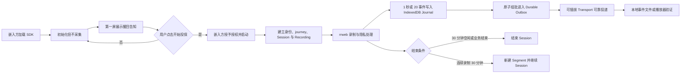

# DI-1001 基于 rrweb Fork 构建 DataInsights 前端 SDK

**需求编号**：DI-1001  
**提出人**：用户  
**提出日期**：2026-10-25  
**优先级**：P0  
**主业务域**：浏览器端用户行为录制 SDK  
**次业务域**：保险销售可回溯、隐私控制、Fork 治理  
**需求类型**：Requirement  

> 作为嵌入方前端研发，我希望通过一行脚本或稳定的 JavaScript API 接入 DataInsights SDK，在用户明确授权后完整记录投保操作，以便支持保险销售可回溯和业务纠纷核验，同时不影响宿主系统并保持 rrweb 底座可持续升级。

## 1. Requirement Metadata

| 项目 | 内容 |
| --- | --- |
| Jira | `DI-1001` |
| Jira 来源 | 用户提供 |
| Jira 同步 | 当前环境无 Jira MCP，同步不可用；未虚构 Jira 标题、描述或验收条件 |
| 目标仓库 | rrweb Fork |
| 实现分支 | `futrue-v1` |
| rrweb 基线 | `e051ddb`，包版本 `2.2.0` |
| 产品名称 | `DataInsights` |

## 2. PRD Provenance

| 项目 | 内容 |
| --- | --- |
| PRD 来源 | `openspec/changes/di-1001/prd/` |
| PRD 版本 | v1.7 |
| PRD 状态 | Confirmed |
| PRD 确认人 | 用户 |
| PRD 确认时间 | 2026-10-25T22:33:38+08:00 |
| Proposal 派生时间 | 2026-10-25T22:33:38+08:00 |

## 3. 背景

保险投保过程需要形成可核验的页面操作记录，以支持销售可回溯和业务纠纷处理。嵌入方需要低成本接入录制能力，但不应直接依赖 rrweb 内部 API，也不能因 SDK 异常影响投保页面。本变更在 rrweb 源码 Fork 内建立独立 DataInsights 产品层，并以最小核心侵入方式保留后续同步官方 rrweb 的能力。

## 4. 目标

1. 提供可通过 Script Tag 或 npm 包接入的 DataInsights 浏览器 SDK。
2. 在用户明确授权后生成完整、可回放且带身份、投保流程、Session、录制和分段元数据的事件流。
3. 默认录制除密码和认证信息以外的业务输入，满足纠纷核验需要，并允许嵌入方扩大屏蔽范围。
4. 实现授权、身份、Session、长录制分段、批次输出、诊断和资源释放等 SDK 产品能力。
5. 保持宿主页面故障隔离，并验证普通页面和主流 SPA 的兼容性。
6. 将 DataInsights 产品能力与 rrweb 上游包分层，确保 Fork 可持续升级。
7. 通过应用级 `appKey` 和浏览器 durable outbox 尽可能降低跨客户应用混用及录制数据丢失风险。
8. 建立从采集序列到持久化回执、缺口对账和容量降级的分层上送质量体系；本期只实现 SDK 与 Mock 契约。

## 5. 核心流程

## 6. 核心规则

### 6.1 接入与发布

1. 源码目录固定为 `packages/datainsights-browser-sdk`。
2. npm 包固定为 `@datainsights/browser-sdk`。
3. 浏览器构建暴露唯一全局对象 `window.DataInsights`。
4. 首要发布产物包括 ESM、TypeScript 类型声明和 Script Tag/CDN 构建；CJS 仅在明确需要时提供。
5. DataInsights 公共 API 不直接暴露 rrweb 内部文件路径或不稳定类型。

### 6.2 授权与启动

1. 嵌入方负责在投保入口第一屏醒目提示：“投保过程操作、页面行为将被记录留存，用于销售可回溯、纠纷核验”。
2. 用户点击“开始投保”后，由嵌入方显式调用授权和启动接口。
3. 授权前不得采集 Replay、性能指标、身份标识或其他数据，也不得补录授权前行为。
4. 撤回授权时立即停止后续录制；历史数据处置不属于本次前端 SDK 范围。

### 6.3 录制与隐私

1. `type="password"` 的输入值始终禁止录制，任何配置不得关闭该保护。
2. 认证令牌、Cookie、请求正文和隐藏安全字段不得进入事件、缓冲区、日志或 Transport。
3. 除上述禁止项外，业务表单输入默认录制。
4. SDK 必须提供 block、mask 和 ignore 规则，使嵌入方可以按自身合规政策扩大屏蔽范围。
5. Canvas 默认关闭，WebGL 本期不支持；文件上传只允许记录非内容元数据。

### 6.4 身份与业务关联

1. 嵌入方可通过 `identify(userId)` 提供其用户唯一标识；SDK 不验证其真实身份。
2. 嵌入方未提供标识时，SDK 在授权后生成第一方随机 UUID。
3. 本期不使用 FingerprintJS 或其他浏览器指纹技术。
4. 嵌入方可提供 `journeyId`，用于关联同一次投保流程中的多个录制 Session。
5. `userId`、`journeyId`、`sessionId`、`recordingId` 和 `segmentId` 具有不同语义，不得互相替代。

### 6.5 Session 与长录制

1. 用户点击“开始投保”并完成授权/启动后创建 Session。
2. 同一标签页内的 SPA 路由切换和页面刷新延续当前 Session；刷新恢复后先生成全量快照。
3. 新标签页创建新 Session，但可使用相同 `journeyId` 关联同一投保流程。
4. 投保完成、取消投保、退出登录、撤回授权、嵌入方登录会话失效或连续 30 分钟无有效操作时结束 Session。
5. 用户在空闲超时后恢复操作，需要重新满足启动条件并创建新 Session。
6. 连续录制每 30 分钟创建新 `segmentId` 和全量快照，但不因此结束 Session。

### 6.6 事件输出与验证

1. 批次至少包含 appKey、schema、SDK、rrweb、录制、投保流程、Session、分段、批次和序列元数据；不重复携带 platform。
2. 本期仅定义可插拔 Transport，并提供内存、文件/下载和 Mock HTTP 测试实现。
3. 事件每 1 秒或 20 条形成持久化窗口；批次先进入 IndexedDB durable outbox，再交给 Transport，仅在匹配且 `persisted: true` 的回执后删除。
4. 断网、刷新和浏览器重启后按 FIFO 恢复；SDK 负责有限重试，但重试只是网络恢复层的一种策略。
5. 每批使用稳定 batchId、连续 sequence、SHA-256 contentHash 和 previousBatchHash；只有匹配且 `persisted: true` 的回执才允许删除 Outbox。
6. Transport 对账契约返回服务端连续序号和缺失区间，SDK 对仍在 Outbox 的批次执行定向重传。
7. 生产鉴权、服务端限流、生产接收 API 及服务端持久化实现不属于本期；使用 Mock Transport 验证回执和对账契约。
8. 事件 fixture 必须能够由兼容的本地播放器回放。
9. 按仓库 `CONTEXT.md`，所有录制数据均视为 **Untrusted Replay Data**；浏览器回放验证必须使用仅允许 `allow-same-origin`、不允许脚本执行的 **Sandboxed Rebuild**。

### 6.7 故障隔离与资源释放

1. rrweb、Worker、序列化或 Transport 异常不得阻断宿主页面，也不得吞掉宿主错误。
2. 重复初始化不得重复注册监听器或产生重复录制。
3. 队列必须具有事件数和字节数上限；达到上限后的 flush、降级或丢弃需要可诊断。
4. `destroy()` 必须停止录制，移除监听器，断开 Observer，终止 Worker，清除定时器和 SDK 自有引用。
5. 页面关闭时只承诺 best effort flush，不承诺最后一批必然成功。

### 6.8 Fork 与上游治理

1. 优先新增 DataInsights 独立包，不修改 `packages/browser-client` 的 rrweb Cloud 语义。
2. 优先通过 rrweb 公共包和扩展点实现能力。
3. 只有公共扩展点不足时才允许修改 recorder、snapshot、types 等核心包。
4. 每个核心补丁必须记录原因、测试、协议影响、升级影响和可移除条件。
5. 原则上禁止破坏 rrweb 事件协议兼容性的修改；例外需单独批准。
6. 保留 MIT License、版权声明、NOTICE、上游 remote、基线 commit 和同步记录。

## 7. 影响范围

- **影响对象**：DataInsights 公共 API、SDK 配置、录制事件、批次契约、身份与 Session 元数据、构建产物、录制 fixture。
- **影响模块**：新增 `packages/datainsights-browser-sdk`；必要时以受控补丁影响 rrweb 公共扩展点或核心包。
- **影响角色**：SDK 研发、嵌入方前端研发、产品/隐私负责人、QA、后续平台研发。
- **影响流程**：投保入口授权、录制启动、页面导航、身份关联、长会话分段、录制结束、本地回放验证、上游同步。

## 8. 本期范围

### 8.1 纳入范围

- DataInsights 独立 SDK 包及公共 API；
- Script Tag/CDN、ESM 和类型声明构建；
- 授权、生命周期、身份、Session 和 `journeyId` 关联；
- rrweb 录制适配、隐私规则、采样、全量快照和长录制分段；
- 批次契约、可插拔 Transport 及测试实现；
- IndexedDB durable outbox、断网/刷新恢复和有限重试；
- 批次内容哈希、持久化回执校验、序列缺口对账、定向重传和容量分级诊断；
- 自定义事件、调试信息、异常隔离和完整资源释放；
- 示例页、本地播放器、事件 fixture、普通页面和 SPA 兼容测试；
- Fork 基线、许可证、补丁登记和上游同步验证机制。

### 8.2 明确排除

- 生产事件接收 API、服务端鉴权、租户解析、限流、配额和服务端持久化；
- PostgreSQL、ClickHouse、MinIO/S3、Kafka、Flink、Redis；
- 正式回放控制台、管理后台、实时回放和视频导出；
- 服务端身份映射、证据签名、法律效力认定、数据留存和删除传播；
- 行为分析、漏斗、路径、留存和用户分群；
- FingerprintJS 和其他浏览器指纹能力；
- yudao-cloud 后端修改或集成。

## 9. Success Criteria

1. `@datainsights/browser-sdk` 可生成 ESM、类型声明和 Script Tag/CDN 产物，后者仅暴露 `window.DataInsights`。
2. 未授权场景下，自动化测试验证无 Replay、性能、身份和持久化数据产生；授权后不出现授权前事件。
3. 密码、认证信息和客户屏蔽区域不出现在事件 fixture；普通业务输入可录制并正确回放。
4. 嵌入方用户 ID 可正确关联；未提供时只在授权后生成第一方随机 UUID；产物不包含 FingerprintJS。
5. 同标签页刷新和 SPA 路由延续 Session，新标签页创建新 Session，30 分钟空闲和全部显式结束条件均可验证。
6. 相同 `journeyId` 可以关联多个 Session；每 30 分钟产生新 segment 和全量快照且 `sessionId` 不变。
7. 内存、文件/下载和 Mock HTTP Transport 均能接收带唯一 batchId 与连续 sequence 的批次。
8. rrweb 或 Transport 故障不会向宿主页面传播未捕获异常；重复初始化不产生重复监听和重复事件。
9. `destroy()` 后不再产生事件，SDK 自有监听器、Observer、Worker、定时器、队列和引用均被释放。
10. 普通 HTML、React、Vue 和 Angular 示例通过录制/回放验证；跨域 iframe、Canvas、WebGL 和 CSP 行为符合声明边界。
11. 本地播放器使用仓库定义的 Sandboxed Rebuild，旧事件 fixture 在底座升级后按兼容策略通过。
12. rrweb 原始测试保持通过；每个 L2/L3 核心补丁均有登记、自动化测试和上游升级影响说明。
13. 不同客户产品平台使用不同 `appKey`；SDK 不接收 platform 或长期 secret，批次可按 appKey 隔离。
14. 断网、刷新和浏览器重启后可恢复未确认批次；持久化队列不静默覆盖数据，无法保证的浏览器存储边界有明确诊断和文档。
15. 普通 HTTP 成功、sendBeacon 已接收或不匹配回执不会删除 Outbox；匹配的持久化回执才能确认批次。
16. Mock Transport 可验证内容哈希、哈希链、连续序号、缺失区间对账和定向重传。

## 10. 已确认事项

| # | 事项 | 确认值 | 确认人 | 确认时间 |
| --- | --- | --- | --- | --- |
| 1 | 实现范围 | 仅前端 SDK 和本地验证工具，不建设生产后端 | 用户 | 2026-10-25 |
| 2 | 底座策略 | Fork rrweb 源码，减少原始代码侵入并保留上游升级能力 | 用户 | 2026-10-25 |
| 3 | 默认输入策略 | 密码不可录制，其他业务输入默认录制 | 用户 | 2026-10-25 |
| 4 | 授权规则 | 嵌入方告知；点击“开始投保”后显式启动；授权前完全不采集 | 用户 | 2026-10-25 |
| 5 | 身份规则 | 嵌入方 ID 优先，第一方 UUID 兜底，不使用 FingerprintJS | 用户 | 2026-10-25 |
| 6 | Session 规则 | 同标签页延续、新标签页新建、30 分钟空闲结束、`journeyId` 关联 | 用户 | 2026-10-25 |
| 7 | 长录制规则 | 每 30 分钟技术分段但不结束 Session | 用户 | 2026-10-25 |
| 8 | 包与发布 | `packages/datainsights-browser-sdk`、`@datainsights/browser-sdk`、`window.DataInsights`、ESM/类型/CDN | 用户 | 2026-10-25 |
| 9 | 应用隔离 | 每个客户产品平台环境使用独立公开 appKey；SDK 不重复接收 platform，长期 secret 不进入浏览器 | 用户 | 2026-10-25 |
| 10 | 可靠投递 | IndexedDB durable outbox；1 秒或 20 条持久化窗口；匹配持久化回执后删除；断网/刷新恢复；有限重试只是策略之一 | 用户（方案 A） | 2026-10-25 |
| 11 | 分层上送质量 | SDK 实现序列、本地持久化、网络恢复、幂等/哈希、持久化回执、缺口对账、容量降级；生产后端只定义契约并 Mock | 用户（方案 A） | 2026-10-26 |

## 11. ASSUMPTIONS I'M MAKING

1. 嵌入方提供的 `userId` 在其自身作用域内唯一；SDK 不承担实名校验或身份真实性证明责任。
2. `journeyId` 由需要跨 Session 还原完整投保流程的嵌入方提供；缺失时 SDK 只能按单个 Session 检索和验证。
3. 录制可作为纠纷核验材料，但证据签名、存证、访问控制、留存期限和法律可采性由后续服务端与合规变更负责。
4. 嵌入方负责将自身登录会话失效、投保完成、取消和退出事件显式通知 SDK。
5. CJS 不是首期必需产物，除非现有构建工具链或明确客户需求证明需要。
6. 本期不承诺恢复 SDK 启动或授权之前的页面状态。
7. Mock HTTP、文件导出和本地播放器仅用于验证 SDK 契约，不构成生产后端。

## 12. 待确认事项

当前没有阻塞 Tasks 的待确认项。以下技术决策已在 Design v1.2 中收口：

| # | 事项 | 需要确定的内容 | 负责人 |
| --- | --- | --- | --- |
| 1 | API 语义 | `start/stop/revoke/flush/destroy` 涉及持久化或 drain 时使用异步 Result | Design D-02 / §5.4 |
| 2 | 可靠投递 | 1 秒或 20 事件 journal、100 MiB outbox、持久化回执、有限重试、对账与定向重传 | Design §9-11 |
| 3 | 上游同步 | 使用 `sync/upstream-<version>` 分支 merge，不重写 Fork 历史 | Design D-06 |
| 4 | 浏览器基线 | Chrome/Edge 109+、Firefox 115 ESR+、Safari 16.4+ | Design §12.3 |
| 5 | 性能预算 | 体积、初始化、事件处理、FPS、内存和持久化容量均已量化 | Design §14 |
| 6 | 有效操作 | click、pointer/touch、键盘、input/change、scroll、SPA 导航和成功自定义事件 | Design §7.3 |

## 13. 术语和决策记录

| 术语或决策 | 已确认含义或选择 | 依据 | 适用范围 |
| --- | --- | --- | --- |
| DataInsights SDK | 面向嵌入方的稳定产品 API，不等同于 rrweb 内部 API | PRD v1.7 | DI-1001 |
| User | 嵌入方 ID 或 SDK 授权后生成的第一方 UUID 所代表的用户 | 用户确认 | 身份关联 |
| Journey | 由 `journeyId` 表示的一次投保业务流程，可包含多个 Session | 用户确认 | 纠纷核验 |
| Session | 一次连续浏览器操作过程，按显式结束或 30 分钟空闲划分 | 用户确认 | 录制边界 |
| Recording | SDK 实际启动后产生的一段连续录制，不含启动前历史 | PRD v1.7 | 事件输出 |
| Segment | 长录制的技术分片，不代表 Session 或 Journey 结束 | 用户确认 | 存储与回放 |
| Untrusted Replay Data | 可能包含攻击者控制 DOM、属性、URL 或媒体状态的 rrweb 数据 | 仓库 `CONTEXT.md` | 本地回放验证 |

## 14. 边界场景

| 场景 | 预期结果 | 原因 | 状态 |
| --- | --- | --- | --- |
| SDK 已加载但用户未点击“开始投保” | 不采集、不生成身份、不持久化录制数据 | 授权前零采集 | 已确认 |
| 页面存在密码字段 | 值不会进入任何事件、日志、队列或 Transport | 强制隐私底线 | 已确认 |
| 嵌入方没有用户 ID | 授权后生成第一方随机 UUID | 匿名兜底 | 已确认 |
| 同标签页刷新 | 延续 Session，生成新的全量快照 | 保持投保过程连续且可回放 | 已确认 |
| 用户在新标签页继续同一投保 | 新建 Session，通过 `journeyId` 关联 | 避免多窗口时间线混淆 | 已确认 |
| 30 分钟无有效操作后恢复 | 原 Session 结束，重新满足启动条件后建立新 Session | 行业常用空闲边界 | 已确认 |
| 连续录制达到 30 分钟 | 新建 segment，Session 不变 | 技术分段不改变业务语义 | 已确认 |
| rrweb 初始化或 Transport 失败 | SDK 进入可诊断降级状态，宿主页面继续工作 | 故障隔离 | 已确认 |
| 页面关闭 | 立即尝试提交尾部持久化窗口；未提交窗口仍不承诺成功 | 浏览器关闭事件不可靠 | 已确认 |
| 回放数据包含恶意 DOM | 仅在 Sandboxed Rebuild 中重建，不执行脚本 | 项目安全上下文 | 已确认 |

## 15. 风险

- 默认录制普通业务输入会扩大敏感数据处理范围，嵌入方必须正确配置额外屏蔽规则并完成合规告知。
- 未提供 `journeyId` 时，多个 Session 无法可靠归并为同一投保流程。
- 深度修改 rrweb 核心会增加上游同步成本，必须严格控制在 L2/L3 补丁门槛内。
- 浏览器关闭、崩溃和移动端后台回收可能造成尾部事件缺失，前端 SDK 无法提供绝对送达保证。
- 浏览器和框架差异可能影响长会话资源占用、页面刷新恢复和 CSP 集成。
- 仅有前端事件不能独立保证证据完整性或法律效力，后续仍需服务端完整性和访问治理能力。

## 16. 复杂度评估

| 评估项 | 结论 |
| --- | --- |
| 复杂度 | 复杂 |
| 原因 | 新增公开 SDK、构建产物、生命周期和数据契约；涉及 rrweb Fork、隐私边界、浏览器兼容及上游治理 |
| 是否需要 `design.md` | 是 |
| 是否需要 `tasks.md` | 是 |
| 是否需要 `test-cases.md` | 是 |
| 后续流程 | proposal 确认 → design → tasks/test-cases → apply |

## 17. 测试要点

- 授权前零采集与授权后不可追溯补录；
- 密码/认证信息强制排除与普通业务输入回放；
- 身份注入、匿名 UUID、清除身份和账号切换；
- 同标签页刷新、新标签页、SPA 导航、空闲超时和显式结束；
- 30 分钟 segment 切换、全量快照及跨 segment 跳转；
- 批次唯一性、序列重复/缺口、队列上限和 Transport 异常；
- 多次初始化、stop/start、授权撤回和 destroy 的幂等性；
- 普通 HTML、React、Vue、Angular、CSP、iframe 和长期运行；
- Sandboxed Rebuild、安全 fixture 和旧事件兼容；
- rrweb 原始回归测试与上游同步演练。

## 18. 依赖与证据

- Confirmed PRD v1.7：`openspec/changes/di-1001/prd/`；
- rrweb Fork 基线：commit `e051ddb`，版本 `2.2.0`；
- rrweb 公共包：`@rrweb/record`、`@rrweb/types`、`@rrweb/utils`；
- 项目安全上下文：根目录 `CONTEXT.md`；
- 行业 Session 参考：Google Analytics、PostHog、NIST Session Management、OWASP Session Management Cheat Sheet；
- Jira `DI-1001` 仅来自用户输入，当前无法同步外部 Jira 事实。

## 19. 下一阶段入口

本 Proposal 只确认“为什么做、做什么以及如何验收”，不授权实现。Proposal 经用户确认后进入 `design.md`，重点完成公共 API、状态机、事件/批次契约、Transport 背压、包构建、核心补丁门槛、安全回放和上游同步方案。

## 20. 变更记录

| 日期 | 版本 | 变更内容 | 变更人 |
| --- | --- | --- | --- |
| 2026-10-26 | v1.2 | 增加分层上送质量、持久化回执、内容哈希、缺口对账与定向重传契约 | Codex |
| 2026-10-25 | v1.1 | 增加 appKey 应用隔离与方案 A 的 IndexedDB durable outbox 可靠投递要求 | Codex |
| 2026-10-25 | v1.0 | 从用户确认的 PRD v1.5 派生 DI-1001 Proposal | Codex |
